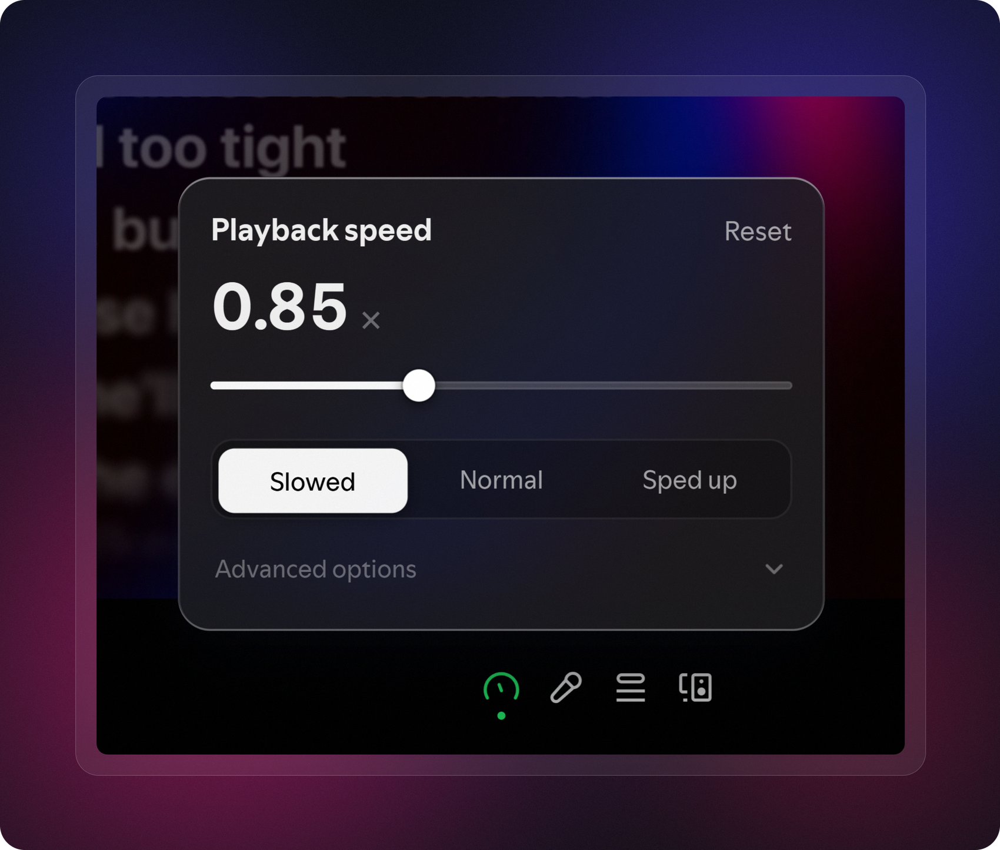

<div align="center">

# Dial

change how fast your music plays, and let the pitch follow or stay put

<p>
  <a href="https://www.typescriptlang.org"></a>
  <a href="https://sass-lang.com"></a>
  <a href="https://spicetify.app"></a>
</p>



</div>

## what it does

Dial puts a gauge in the playbar that changes how fast a song plays, anywhere from 0.5x to 1.5x. when a song slows down its pitch drops with it, the way a record does on a turntable, because Spotify's own engine resamples it. it's not a pitch corrected time stretch, so it doesn't have that warbly sound. if you'd rather keep the key you can lock the pitch, which gives you the stretch, the same thing a podcast speed control does

lyrics stay in sync, since what changes is the player's own clock. the seekbar, the time labels and clicking a lyric line all land where they should

## install

through the [Spicetify Marketplace](https://github.com/spicetify/marketplace), search for Dial and install it. or by hand, put `dist/dial.js` in your Spicetify extensions folder and run

```sh
spicetify config extensions dial.js
spicetify apply
```

a gauge shows up in the playbar, next to the lyrics button

## usage

click the gauge. the slider goes from 0.5x to 1.5x and sticks to the presets as you drag past them. Slowed, Normal and Sped up are presets you can change, in advanced options you can rename them, give them any rate you want, lock the pitch and pick which timeline the time labels use. Reset always takes you back to exactly 1x

you can also drag the gauge in the playbar itself. it turns between your presets and applies when you let go

the timeline is real time by default, which counts seconds like a clock, so a slowed song shows a longer total length because that's how long it will really take. song time counts the song's own seconds instead, so the clock runs slow. hover a time label and it rolls over to the other one

## what to know

this can stop working at any time. the speed is something Spotify provides, Dial only asks for it, and there's no way to know when Spotify will change or remove it. when that happens the panel says so instead of quietly doing nothing. a Spotify version number says nothing about it, because the same version can work one day and not the next

podcasts and local files aren't supported, Spotify's own speed control already covers podcasts. applying a speed reloads the current track once, at the same position, and hands Spotify an inline page of the next tracks in your queue, going back to the real context at the end of it. shuffle is held off while the rate isn't 1x and handed back when you return to it, because re-issuing the queue with shuffle on makes Spotify re-roll the order

## about the code

the interface is hand written TypeScript and Sass with no UI framework, built with Spicetify Creator, which bundles with esbuild. the icons are from [Lucide](https://lucide.dev), and the UI ideas and effects come from [React Bits](https://reactbits.dev), [Magic UI](https://magicui.design) and [Aceternity UI](https://ui.aceternity.com), rewritten as plain DOM and CSS

Dial doesn't touch Spotify's binaries. it's one JavaScript file that Spicetify loads inside the client, and the only thing it asks of Spotify is metadata on the tracks it plays

## how it works

music on desktop is played by Harmony, Spotify's native engine, so there is no audio element to speed up. what Harmony does do is read two undocumented metadata keys on the tracks it's given, `item.speed` and `audio.pitch_factor`, and Dial attaches them to the queue it hands to `PlayerAPI.play()`. no audio is decrypted or intercepted. to keep the seekbar, the time labels and lyrics right it does wrap a few of the player's own JavaScript methods. that wrapping is the part most likely to break when Spotify changes something

giving both keys the same value is a real resample. leave the pitch key out and Harmony corrects the pitch instead, which is what the lock does

for bug reports, `Dial.support` in the DevTools console tells you which of the two keys your Spotify honors
